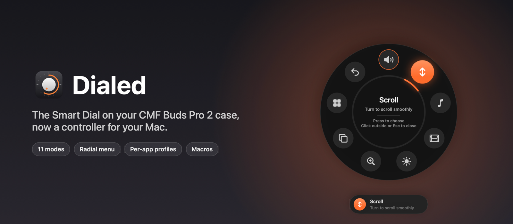
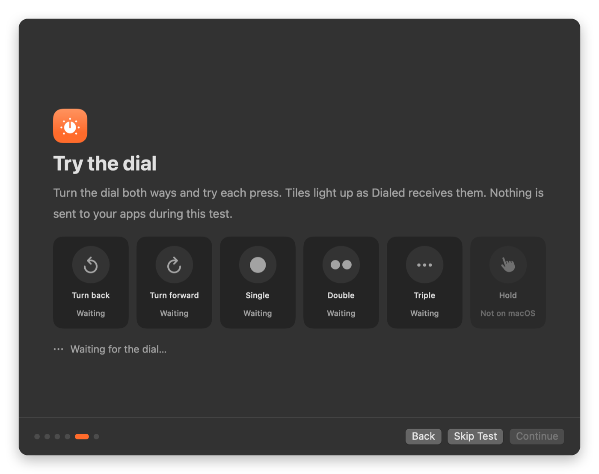
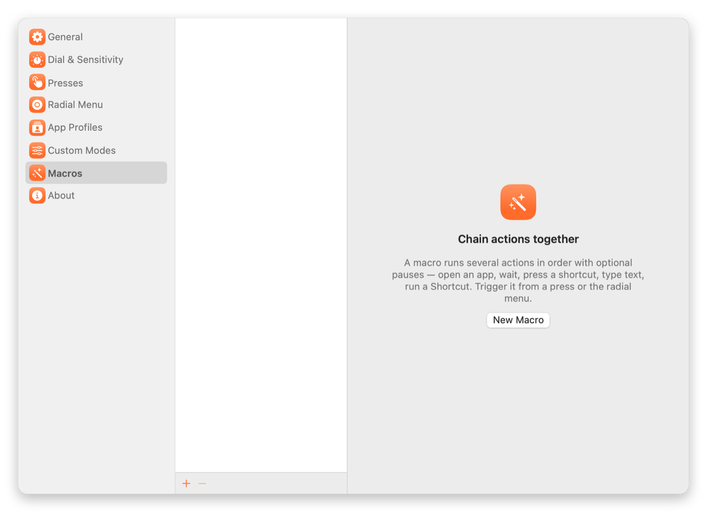

<p align="center">
  
</p>

<p align="center">
  <a href="https://github.com/taqionvibe/dialed/releases/latest"></a>
  <a href="https://github.com/taqionvibe/dialed/actions/workflows/ci.yml"></a>
  
  
  
  <a href="LICENSE"></a>
</p>

<p align="center">
  <a href="https://github.com/taqionvibe/dialed/releases/latest/download/Dialed.dmg">
    
  </a>
</p>

<p align="center">
  Turn to scroll, seek, zoom, flip slides or switch tabs. Triple-press for a radial menu of modes.<br>
  Profiles follow the app you're using. Native, private, and tested with real buds.
</p>

<p align="center"><sub>Made with ❤️ by <a href="https://taqisaeed.com">Taqi Saeed</a></sub></p>

<br>

## ✨ What it does

<table>
  <tr>
    <td width="33%" valign="top">
      <h3>🎛️ 11 modes</h3>
      Volume, smooth Scroll, Media, Video Seek, Brightness, Zoom, Browser Tabs, Slides, App Switcher, Windows and Undo / Redo — plus your own custom modes.
    </td>
    <td width="33%" valign="top">
      <h3>⭕ Radial menu</h3>
      Triple-press the dial to open it, turn to pick a mode, press to choose. Or click it. It never steals focus from your app.
    </td>
    <td width="33%" valign="top">
      <h3>🧩 Per-app profiles</h3>
      Keynote starts in Slides, Safari in Scroll, QuickTime in Video Seek. Dialed switches automatically with the front app.
    </td>
  </tr>
  <tr>
    <td valign="top">
      <h3>⚡ Shortcuts & macros</h3>
      Map presses and turns to keyboard shortcuts, Apple Shortcuts, apps, links, typed text, or multi-step macros.
    </td>
    <td valign="top">
      <h3>🎵 Plays nice with music</h3>
      Single press pauses your real player, double press skips — YouTube Music, Spotify, Music, browsers.
    </td>
    <td valign="top">
      <h3>🛡️ Thoughtful by default</h3>
      Fast-spin boost, accidental-turn guard, sleep/wake and reconnect handling, and a one-click off switch.
    </td>
  </tr>
</table>

<p align="center">
  
  &nbsp;&nbsp;
  
</p>

## 🚀 Get started

**1. Install.** Download **[Dialed.dmg](https://github.com/taqionvibe/dialed/releases/latest/download/Dialed.dmg)**, open it and drag Dialed to Applications. The first time, **right-click Dialed → Open** (the app isn't notarized yet). Prefer a zip? It's on the [Releases page](https://github.com/taqionvibe/dialed/releases).

**2. Set up the dial in Nothing X.** Open **CMF Buds Pro 2 → Controls → Dial**:

| Gesture | Set it to | In Dialed |
|---|---|---|
| Single press | **Play / Pause** | the mode's action |
| Double press | **Next track** | next song |
| Triple press | **Previous track** | opens the radial menu |
| Turn | **Volume** (default) | drives the current mode |
| Press and hold | anything | ⚠️ never reaches macOS |

> Triple press only reaches the Mac when it's set to **Previous track** — "Low lag mode" or "No action" send nothing.

**3. Allow Accessibility.** The setup guide opens the right pane: *System Settings → Privacy & Security → Accessibility* (macOS 27: *Device Control and Data Access*). It's needed to send keys and scroll. Dialed asks for nothing else and never touches the network.

<p align="center">
  
  
</p>

## 🎚️ Modes

| | Mode | Turn | Press |
|:-:|---|---|---|
| 🔊 | **Volume** | volume | play / pause |
| ↕️ | **Scroll** | smooth scrolling, fast spins go further | vertical ⇄ horizontal |
| 🎵 | **Media** | next / previous track | play / pause |
| 🎬 | **Video Seek** | ← / → | play / pause |
| ☀️ | **Brightness** | display brightness | dim / restore |
| 🔍 | **Zoom** | ⌘+ / ⌘− | ⌘0 |
| 🗂️ | **Browser Tabs** | ⌃⇥ / ⌃⇧⇥ | new tab |
| 📽️ | **Slides** | next / previous slide | black screen |
| 🪟 | **App Switcher** | the real ⌘⇥ switcher | switch to the app |
| 🧱 | **Windows** | ⌘\` / ⌘⇧\` | Mission Control |
| ↩️ | **Undo / Redo** | ⌘Z / ⇧⌘Z | save |

## 📸 Screenshots

<table>
  <tr>
    <td></td>
    <td></td>
  </tr>
  <tr>
    <td align="center"><sub>Radial menu</sub></td>
    <td align="center"><sub>Remap every press, per profile</sub></td>
  </tr>
  <tr>
    <td></td>
    <td></td>
  </tr>
  <tr>
    <td align="center"><sub>Edit the radial menu</sub></td>
    <td align="center"><sub>Speed, direction and accidental-turn guard</sub></td>
  </tr>
  <tr>
    <td></td>
    <td></td>
  </tr>
  <tr>
    <td align="center"><sub>Macros</sub></td>
    <td align="center"><sub>Live diagnostics of every turn and press</sub></td>
  </tr>
</table>

## 💡 Good to know

- **Off means off.** The menu bar toggle releases the buds completely — turning changes volume and presses control your music, as if Dialed weren't installed.
- **macOS volume indicator.** Every dial click *is* a volume change to macOS, so its indicator appears. No public API hides it.
- **Now Playing.** macOS only sends the buds' presses to the app shown under Now Playing, so Dialed appears there while it's on. It leaves when the buds go in the case.
- **Fast spins.** The buds report about one click every half second while spinning and drop the rest; Dialed boosts fast spins to make up for it.
- **Stray clicks.** After a pause, the first click is ignored in modes where it would matter (Undo, Tabs, App Switcher, Windows, Media).
- **Backups.** Export and import all settings as JSON from Settings → General.

<details>
<summary><b>🔬 Tested on real hardware</b></summary>

<br>

Verified on a MacBook Pro running macOS 27.0.1 with real CMF Buds Pro 2: turns, single / double / triple presses, volume restore, the radial menu, all built-in modes (Volume, Scroll, Media, Video Seek, Brightness, Zoom, Browser Tabs, Slides, App Switcher, Windows, Undo / Redo), macros and Apple Shortcuts, play-pause and next track forwarded to YouTube Music, keeping the presses while music plays, the buds going in and out of the case, sleep / wake, and the off switch.

Full report, including what is still untested: [docs/HARDWARE-TESTING.md](docs/HARDWARE-TESTING.md).

</details>

<details>
<summary><b>⚙️ How it works</b></summary>

<br>

```
CMF Buds Pro 2 ──AVRCP──▶ macOS
   turn  = absolute volume ──▶ CoreAudio volume of the buds ──▶ VolumeClickDecoder ─┐
   press = play/next/prev  ──▶ MPRemoteCommandCenter (Dialed is "now playing") ─────┤
                                                                                     ▼
                     DialEngine (modes, radial menu, profiles) ──▶ CGEvent keys/scroll,
                     brightness, media forwarding, Shortcuts, macros, HUD
```

- Turns are volume steps on a 16-step grid. Outside Volume mode, Dialed restores your volume right after each click (≈30 ms), so the dial works without changing what you hear.
- A silent audio stream keeps the Mac the buds' active device; otherwise turns go to whichever device last played audio.
- Dialed holds "now playing" to receive presses, forwards play/pause/next to your real player, and takes the presses back when a music app grabs them on a track change.

| Target | Contents |
|---|---|
| `DialedCore` | pure logic — click decoding, spin boost, accidental-turn guard, gesture engine, mode planner, settings. Unit-tested, including replays of real buds recordings |
| `DialedPlatform` | CoreAudio monitor, silent stream, remote commands, CGEvent output, brightness, Shortcuts, audio-process watcher |
| `Dialed` | SwiftUI + AppKit menu bar app — onboarding, settings, diagnostics, radial menu and HUD panels |

</details>

<details>
<summary><b>🛠️ Build from source</b></summary>

<br>

```bash
swift test                        # unit tests
scripts/build-app.sh              # build/Dialed.app + build/Dialed.zip
scripts/build-app.sh universal    # arm64 + x86_64
pip install dmgbuild && scripts/build-dmg.sh   # build/Dialed.dmg
```

Swift 6 toolchain (Xcode 16+), macOS 14+. Set `SIGN_IDENTITY="Developer ID Application: …"` to sign. For local development, `STABLE_DEV_IDENTITY=1` keeps the Accessibility grant across rebuilds — never ship that build. `Dialed --render-screenshots <dir>` renders every screen to PNG without touching audio.

CI runs the tests and builds a universal app and DMG on every push and pull request; `v*` tags publish a GitHub Release.

</details>

## 🙏 Credits

Dial decoding builds on the research in [Orbit](https://github.com/harsha20599/orbit) by harsha20599 (MIT) — see [LICENSE](LICENSE). Dialed is not affiliated with or endorsed by Nothing or CMF.

<br>

<p align="center">
  Made with ❤️ by <a href="https://taqisaeed.com"><b>Taqi Saeed</b></a><br>
  <a href="https://taqisaeed.com">taqisaeed.com</a>
</p>
