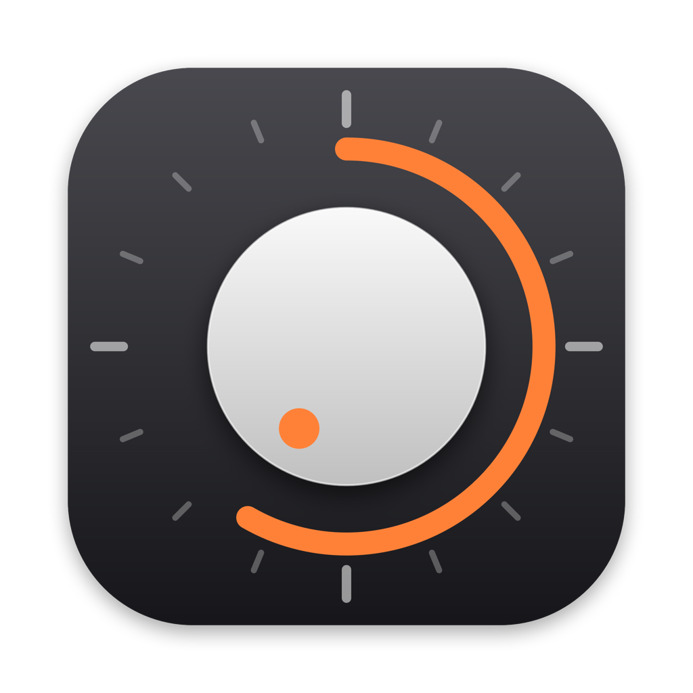
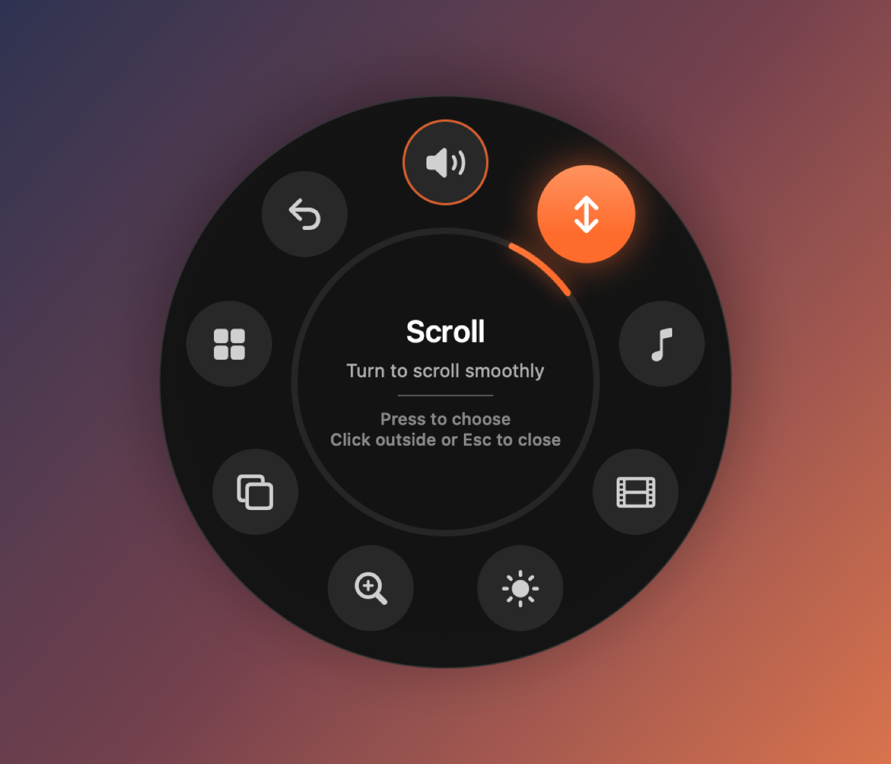
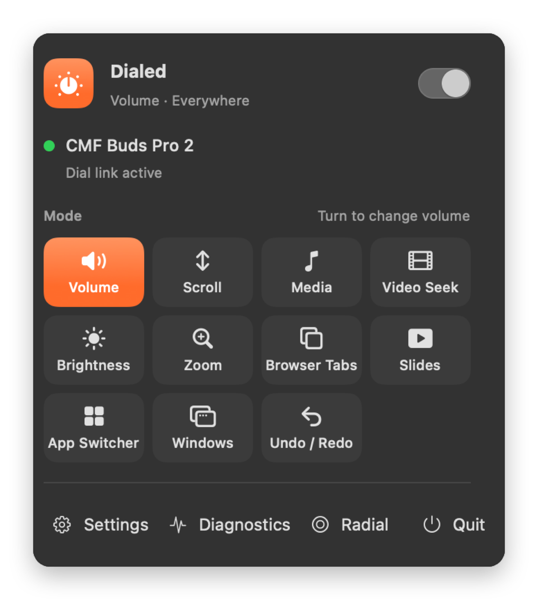
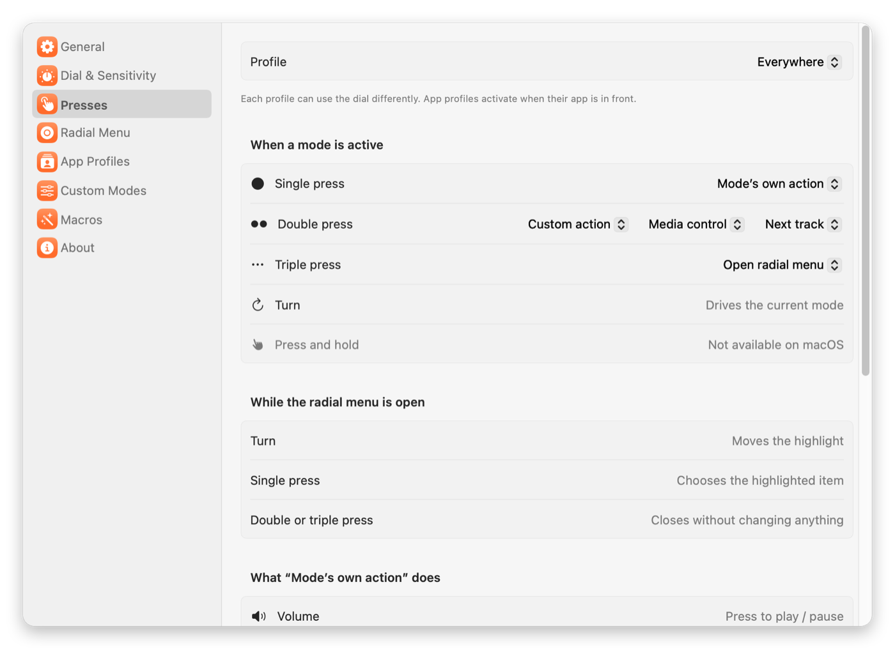
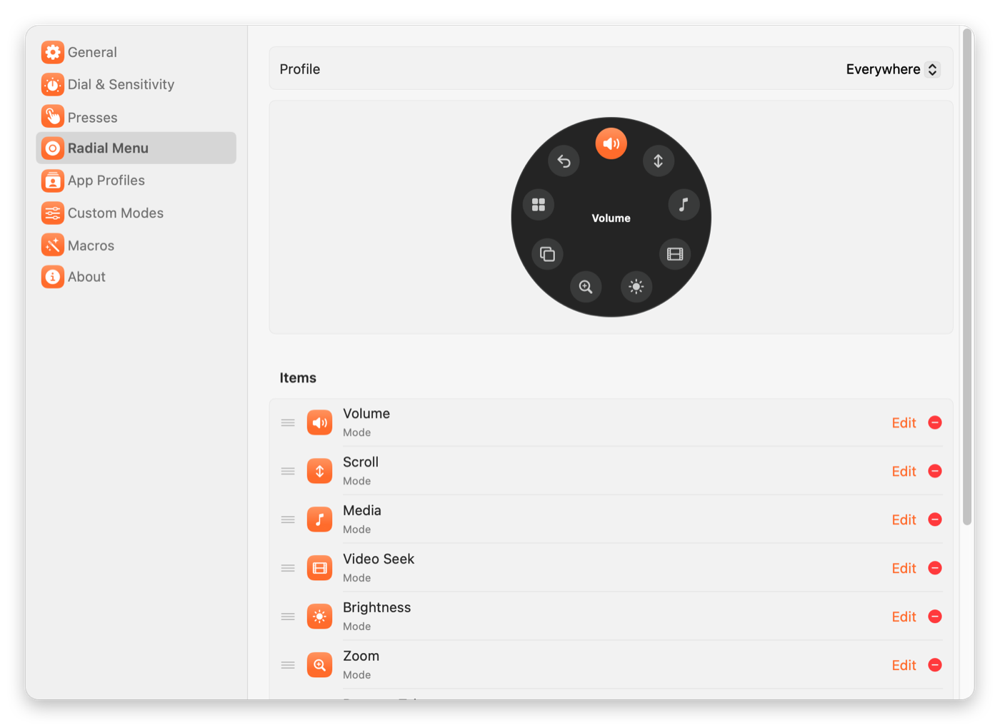
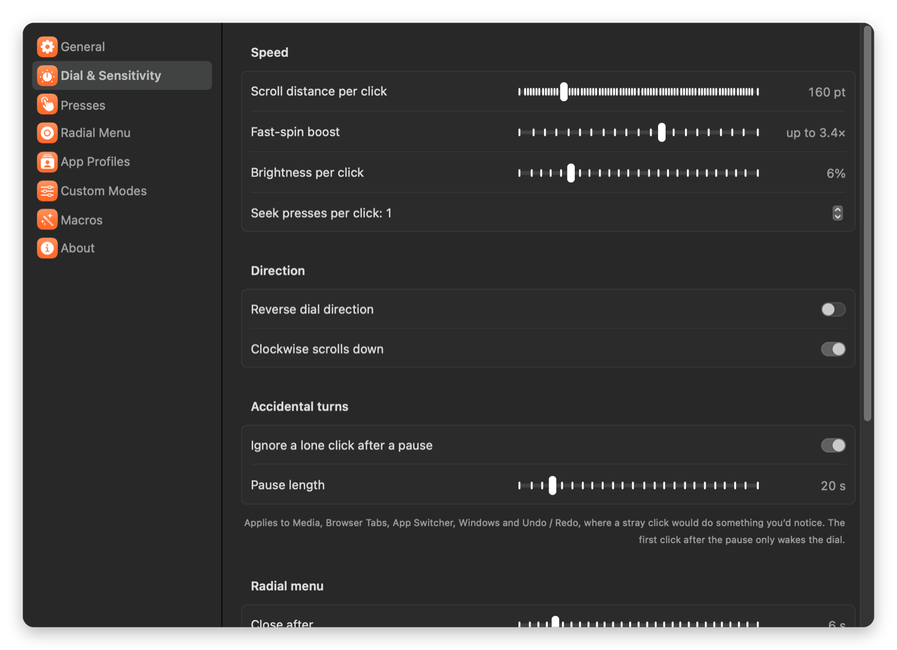
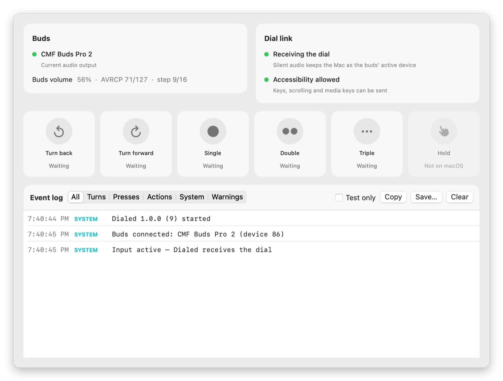
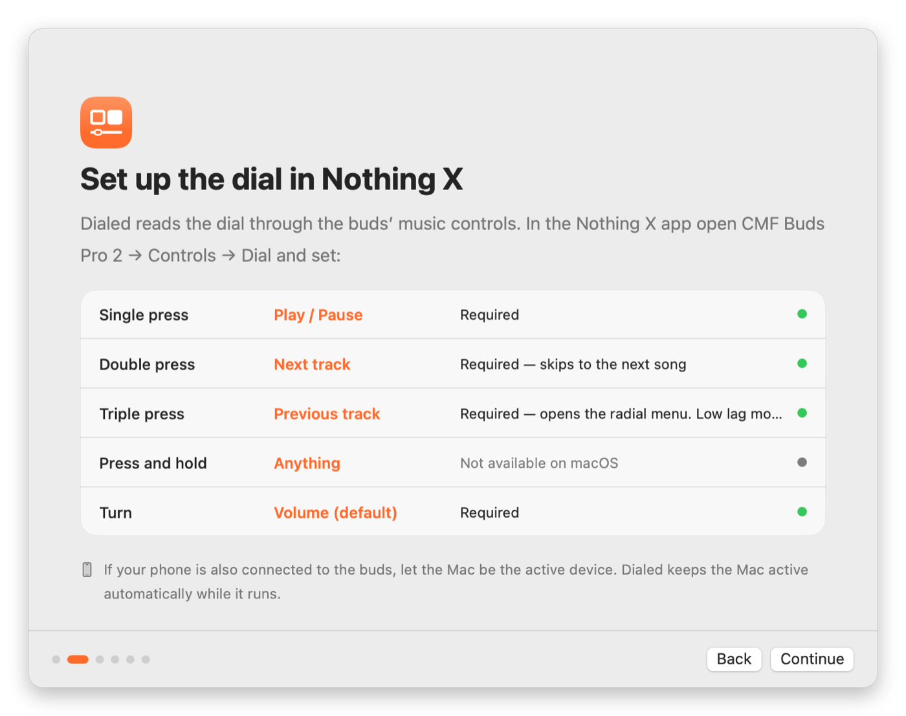
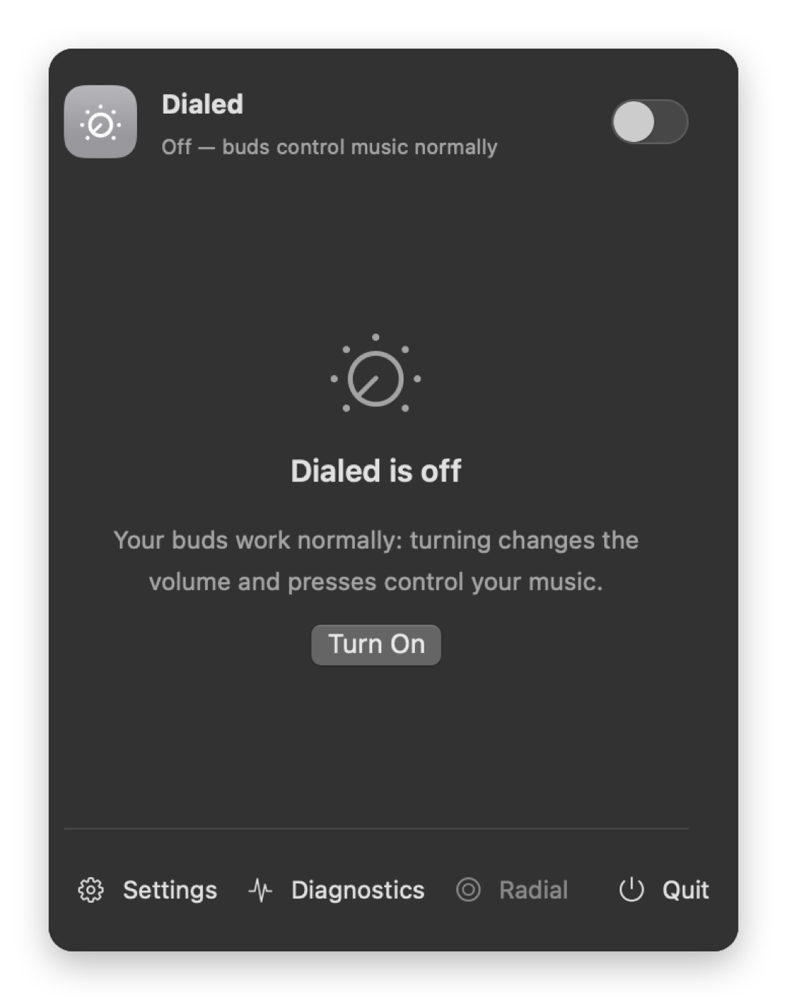

<p align="center"></p>

<h1 align="center">Dialed</h1>

<p align="center"><b>The Smart Dial on your CMF Buds Pro 2 case, as a Mac controller.</b><br>
Turn to scroll, seek, zoom, switch tabs and more. Triple-press for a radial menu of modes.<br>
Per-app profiles, custom modes, macros and Apple Shortcuts. Native Swift, menu bar only.</p>

<p align="center">
  
  
</p>

> Tested on a real Mac (macOS 27) with real CMF Buds Pro 2 — see
> [docs/HARDWARE-TESTING.md](docs/HARDWARE-TESTING.md) for exactly what was verified.

## Install

1. Download **Dialed.zip** from the [Releases page](https://github.com/taqionvibe/dialed/releases)
   (or the `Dialed-app` artifact of the newest CI run), unzip it and drag **Dialed.app** to
   **Applications**.
2. The first time, **right-click Dialed → Open** (the app isn't notarized).
3. Follow the setup window. Dialed lives in the menu bar (the dial icon).

Requires macOS 14 Sonoma or later and CMF Buds Pro 2 paired with the Mac.

## Set up the dial in Nothing X (required)

Dialed reads the dial through the buds' music controls. In the **Nothing X** app open
**CMF Buds Pro 2 → Controls → Dial** and set:

| Dial gesture | Set it to | Why |
|---|---|---|
| Single press | **Play / Pause** | the mode's action (e.g. play/pause, new tab, black screen) |
| Double press | **Next track** | next song |
| Triple press | **Previous track** | opens Dialed's radial menu. Other choices (Low lag mode, No action) never reach the Mac |
| Turn | **Volume** (default) | drives the current mode |
| Press and hold | anything | **not available on macOS** — the Mac never receives it |

## Permissions

| Permission | Why | Where |
|---|---|---|
| **Accessibility** (macOS 27: *Device Control and Data Access*) | send keys, smooth scrolling and media keys | System Settings → Privacy & Security |
| Automation (optional) | play/pause Spotify or Music directly | asked the first time it's used |

Dialed needs no microphone, Bluetooth or screen-recording access and sends nothing over the network.

## Using it

| Do this | A mode is active | The radial menu is open |
|---|---|---|
| **Turn** | drives the mode | moves the highlight |
| **Single press** | the mode's action | chooses the highlighted item |
| **Double press** | next track | closes the menu |
| **Triple press** | opens the radial menu | closes the menu |
| Click outside / Esc | — | closes the menu |

Every press can be remapped per profile (Settings → Presses).

### Modes

| Mode | Turn | Press |
|---|---|---|
| Volume | volume | play / pause |
| Scroll | smooth scrolling (fast spins go further) | switch vertical / horizontal |
| Media | next / previous track | play / pause |
| Video Seek | ← / → (YouTube, QuickTime, most players) | space (play / pause) |
| Brightness | built-in display brightness | dim / restore |
| Zoom | ⌘+ / ⌘− | ⌘0 |
| Browser Tabs | ⌃⇥ / ⌃⇧⇥ | new tab |
| Slides | next / previous slide | black screen (B) |
| App Switcher | the real ⌘⇥ switcher | switch to the app |
| Windows | ⌘\` / ⌘⇧\` | Mission Control |
| Undo / Redo | ⌘Z / ⇧⌘Z | save |
| **Custom modes** | any action per direction | any action |

Actions can be keyboard shortcuts, media keys, system actions (Mission Control, lock screen…),
**Apple Shortcuts**, opening apps or links, typing text, or **macros** (several actions with pauses).

### Profiles

Profiles give apps their own radial menu, presses, start mode and speed. Dialed switches profile
automatically when an app comes to the front (ready-made: Presentations, Browsing, Video).

<p align="center">
  
  
</p>
<p align="center">
  
  
</p>
<p align="center">
  
  
</p>

### Good to know

- **Turning Dialed off** (menu bar toggle) releases the buds completely: turning changes volume
  and presses control your music, exactly as without Dialed.

  
- **The macOS volume indicator** appears on each click. Every dial click *is* a volume change to
  macOS, and no public API hides the indicator.
- **Now Playing**: macOS only sends the buds' presses to the app shown under Now Playing, so Dialed
  appears there while it's on and the buds are connected. It leaves when the buds go in the case.
- **Fast spins**: the buds report about one click every half second while spinning and drop the
  rest; Dialed boosts fast spins to make up for it (Settings → Dial & Sensitivity).
- **A stray click after a pause** is ignored in modes where it would matter (Undo, Tabs, App
  Switcher, Windows, Media). Turn again to continue.
- **Diagnostics** (menu bar → Diagnostics) shows every turn and press as it arrives, with a
  "Test only" switch, and can save a log for bug reports.
- **Settings** can be exported and imported as JSON (Settings → General).

## How it works

```
CMF Buds Pro 2 ──AVRCP──▶ macOS
   turn  = absolute volume ──▶ CoreAudio volume of the buds ──▶ VolumeClickDecoder ─┐
   press = play/next/prev  ──▶ MPRemoteCommandCenter (Dialed is "now playing") ─────┤
                                                                                     ▼
                     DialEngine (modes, radial menu, profiles) ──▶ CGEvent keys/scroll,
                     brightness, media forwarding, Shortcuts, macros, HUD
```

- Turns are volume steps on a 16-step grid. In every mode except Volume, Dialed puts your volume
  back right after each click (≈30 ms), so the dial works without changing what you hear.
- A silent audio stream keeps the Mac the buds' active device; without it turns go to whichever
  device last played audio.
- Dialed holds "now playing" to receive presses, forwards play/pause/next to your real player, and
  re-claims the presses when a music app takes them on a track change.

| Package target | Contents |
|---|---|
| `DialedCore` | pure logic: click decoding, spin boost, accidental-turn guard, gesture engine, mode planner, settings — fully unit-tested, including a replay of real buds recordings |
| `DialedPlatform` | CoreAudio monitor, silent stream, remote commands, CGEvent output, brightness, Shortcuts, audio-process watcher |
| `Dialed` | SwiftUI/AppKit menu bar app: onboarding, settings, diagnostics, radial menu and HUD panels |

## Build from source

```bash
swift test                       # unit tests
scripts/build-app.sh             # build/Dialed.app and build/Dialed.zip
scripts/build-app.sh universal   # arm64 + x86_64 (what CI ships)
```

Xcode 16+ / Swift 6 toolchain, macOS 14+. `SIGN_IDENTITY="Developer ID Application: …"` signs with
your certificate. For local development, `STABLE_DEV_IDENTITY=1` keeps the Accessibility grant
across rebuilds (never ship such a build). `Dialed --render-screenshots <dir>` renders every screen
to PNG without touching audio.

CI (GitHub Actions) runs the tests, builds and verifies a universal app bundle on every push and
pull request, and publishes a GitHub Release with `Dialed.zip` for `v*` tags.

## Credits

Dial decoding is based on the research in [Orbit](https://github.com/harsha20599/orbit) by
harsha20599 (MIT) — see [LICENSE](LICENSE). Dialed is not affiliated with or endorsed by Nothing or CMF.
